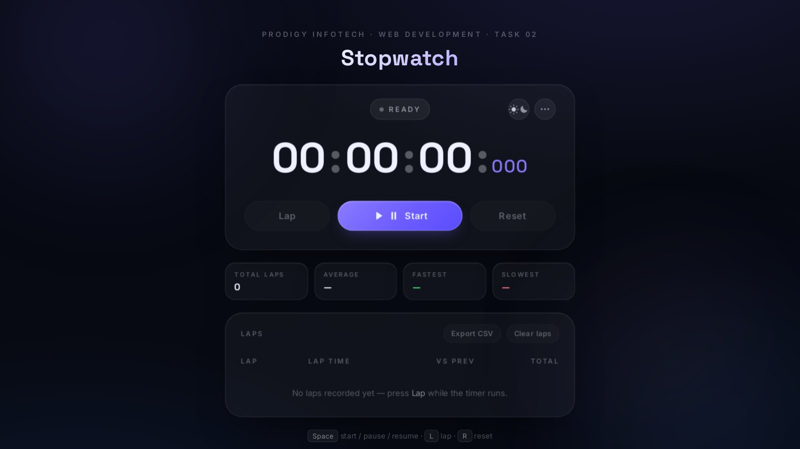

# PRODIGY_WD_04 — Personal Portfolio Website

**A recruiter-friendly personal portfolio for a Computer Science undergraduate — a static public page
with a Supabase-backed content layer and a private admin dashboard.**

[](https://adityajais7026.github.io/PRODIGY_WD_04/)
[](https://adityajais7026.github.io/PRODIGY_WD_04/admin/)


Built for **Prodigy Infotech Web Development Internship — Task 04**, for **Aditya Prakash**, a B.Tech
Computer Science and Engineering student at Galgotias University and an aspiring software developer.

> **Task 04 brief:** Build a personal portfolio website that showcases your skills, projects, and
> accomplishments as a web developer. Design an attractive and visually appealing layout that captures
> visitors' attention. Include a home page with a captivating headline, professional photo, and summary
> of your skills. Provide an "About Me" section with a detailed background, education, and professional
> experience.

| Resource | URL |
|---|---|
| Live site | <https://adityajais7026.github.io/PRODIGY_WD_04/> |
| Admin dashboard | <https://adityajais7026.github.io/PRODIGY_WD_04/admin/> |
| Repository | <https://github.com/adityajais7026/PRODIGY_WD_04> |

---

## Table of Contents

- [Screenshots](#screenshots)
- [Overview](#overview)
- [Pages and sections](#pages-and-sections)
- [Features](#features)
- [Architecture](#architecture)
- [Admin dashboard](#admin-dashboard)
- [Database](#database)
- [Storage buckets](#storage-buckets)
- [Client module contracts](#client-module-contracts)
- [Cache busting](#cache-busting)
- [Project structure](#project-structure)
- [Run locally](#run-locally)
- [Deployment](#deployment)
- [Verification and testing](#verification-and-testing)
- [Current content status](#current-content-status)
- [Technologies](#technologies)
- [Author](#author)
- [License](#license)

---

## Screenshots

> **Placeholders.** No interface screenshots are committed to this repository yet, so the slots below
> are deliberately empty rather than filled with mock-ups. Only `assets/stopwatch-preview.jpg` — the
> real preview used by the Stopwatch project card — exists as a tracked image, and it is shown at the
> end of this section.
>
> To fill a slot: capture the real page, save it as `docs/screenshots/<name>.png` and replace the
> placeholder line with ``. Genuine review captures already
> exist in the git-ignored `artifacts/` folder and can be copied there.

| View | Suggested file | What it should show |
|---|---|---|
| Home / hero — desktop | `docs/screenshots/home-desktop.png` | Hero headline, portrait, availability badge and navigation at ≥1280 px |
| Home / hero — mobile | `docs/screenshots/home-mobile.png` | Same hero at ≤430 px with the menu button |
| Projects section | `docs/screenshots/projects.png` | Project cards with technology chips and link buttons |
| Admin dashboard | `docs/screenshots/admin-dashboard.png` | Signed-in Overview with counters and the sidebar |

<!-- Screenshot placeholders — replace with real captures -->

_Home / hero (desktop) — placeholder_

_Home / hero (mobile) — placeholder_

_Projects section — placeholder_

_Admin dashboard — placeholder_

The one tracked visual, used by the Stopwatch project card and as its fallback preview:



---

## Overview

The public site is a single page built with plain HTML5, CSS3 and vanilla JavaScript — no framework,
no build step and no bundler. All portfolio content (profile, education, skills, projects, experience,
achievements and social links) is managed from the admin dashboard, stored in **Supabase**
(PostgreSQL + PostgREST + Auth + Storage), and read at runtime by `app-data.js`.

The markup in `index.html` ships with the current published content, so the page is complete even if
the API is slow or unreachable: any failed request, or a database with no published rows, leaves the
static content exactly as it is.

| Route | Purpose | Indexing |
|---|---|---|
| `/` | Public portfolio page | Indexed |
| `/admin/` | Private content dashboard | `noindex, nofollow` |

---

## Pages and sections

Home (hero) → About → Skills → Experience → Projects → Achievements → Coding profiles → Contact.

- **Hero** — name, headline, skill summary line, introduction, availability badge, "View Projects",
  "About Me", an optional **Résumé** button (shown only when a résumé is uploaded) and GitHub /
  LinkedIn / LeetCode links.
- **About** — background paragraphs from the profile record, focus points, an education card
  (degree, institution, dates, CGPA, status) and quick facts.
- **Skills** — published skills grouped by category (Languages, Frameworks & Libraries, Databases,
  Tools, Concepts), each group rendered with an icon.
- **Experience** — timeline of roles with organization, period label and description.
- **Projects** — cards with preview image (or a concept panel when no screenshot exists),
  description, technology chips and GitHub / Live Demo buttons for the links that actually exist.
- **Achievements** — cards for practice milestones and internship work, with an optional certificate
  link and year when supplied.
- **Coding profiles** — cards generated from the published social links.
- **Contact** — email address and GitHub / LinkedIn / LeetCode links in a two-column layout. There is
  no contact form: the site is static, so the email link and profiles are the contact routes.

---

## Features

- **Sticky, responsive navigation** with smooth scrolling, scroll-spy active-section highlighting, a
  keyboard-accessible mobile menu (Escape to close) and a skip link.
- **Content management** — every section above is editable from `/admin/` without touching code.
- **Graceful degradation** — a failed or empty Supabase response keeps the built-in static content; a
  broken image URL falls back to a concept panel (projects) or the initials portrait (hero).
- **Accessibility** — semantic landmarks, correct heading order, visible focus states, alt text,
  `aria-expanded` / `aria-controls` on the menu button, trapped focus in dashboard dialogs and
  `prefers-reduced-motion` support for all reveal animations.
- **Performance** — no libraries and no build step on the public page; one stylesheet, one small
  page script, one data layer and two images. Google Fonts (Manrope, `display=swap`) is the only
  external resource there.
- **Resilience** — public requests abort after 8 seconds; dashboard requests are capped at 10 seconds
  and show a retry panel instead of an endless spinner.
- **Design system** — deep navy typography, indigo accent with a restrained violet gradient, subtle
  dot-texture hero, concept preview panels, refined cards, timeline and hover states.

---

## Architecture

```
index.html  →  config.js (URL + publishable key)
            →  app-data.js  →  Supabase PostgREST  →  profiles / education / skills /
                                                     projects / experience / achievements /
                                                     social_links
```

`config.js` holds the Supabase project URL and the **publishable** (anon) key — the only credential
shipped to the browser. `app-data.js` then requests every table in parallel and only ever asks for
`published=eq.true`; row-level security is the enforcement, so drafts and unpublished rows are not
readable by the public.

- Content becomes the source of truth once the database has rows: deleting or unpublishing a record is
  reflected on the next page load.
- Queries are ordered (`display_order`, `featured`, dates) so the visual order stays intentional.
- Project cards reuse the status label declared in their own markup (for example *In Development*) and
  the screenshot bundled in `assets/`, unless the record has an uploaded `image_url`.
- Each table is fetched independently (`Promise.allSettled`), so one failing table degrades only its
  own section instead of the whole page.

### Authentication and authorisation

- The dashboard signs in with **Supabase Auth** (email + password); public sign-up is disabled on the
  project, so accounts are created in the Supabase dashboard.
- Being signed in is not enough: every write is authorised by **row-level security** against the
  administrator allowlist, and the dashboard additionally calls `public.current_admin_state()` to
  decide whether to render the app at all.
- The browser never holds a service-role key; it uses the publishable key plus the signed-in session.

---

## Admin dashboard

A single-page dashboard, served from the same repository, for managing the published content.

| Area | What it does |
|---|---|
| Sign-in | Supabase Auth email + password; no public sign-up |
| Overview | Record counts, published/draft totals and content-health checks |
| Profile | Edit the profile record, avatar and résumé |
| Education, Skills, Experience, Projects, Achievements, Social links | Full CRUD with publish/unpublish, display order and a featured flag for projects |
| Settings | Résumé upload, password change, storage bucket health, sign out of this device or all devices |

- **CRUD** for every content table, with publish/unpublish, display order and a featured flag for
  projects.
- **Uploads** to Supabase Storage buckets: `project-shots` (project screenshots), `profile-photos`,
  `resume` (PDF) and `certificates`.
- **Dialogs** are keyboard operable: focus moves into the dialog, Tab and Shift+Tab stay inside it,
  Escape closes it and focus returns to the button that opened it.
- The dashboard exposes no credentials: it uses the same publishable key and the signed-in session,
  and the database policies do the authorising.
- If the admin RPC from `0005` is missing, `/admin/` shows a setup panel containing the exact SQL
  instead of failing silently.

---

## Database

Seven content tables plus administrator helpers and storage policies. The SQL used to provision them
lives in `supabase/migrations/`.

| Table | Holds | Public read |
|---|---|---|
| `profiles` | The singleton profile: name, title, location, email, availability, intro, about, avatar URL, résumé URL | Published row only |
| `education` | Institutions, degrees, dates, grade, description | Published rows |
| `skills` | Skill name, category, level (1–5) | Published rows |
| `projects` | Cards: name, description, technologies, links, image, featured flag, order | Published rows |
| `experience` | Roles, organisations, period labels, descriptions | Published rows |
| `achievements` | Awards and milestones, with optional date and certificate image | Published rows |
| `social_links` | Platform, optional label, URL | Published rows |

### Migrations

| File | Purpose |
|---|---|
| `0001_core_administrators_helpers.sql` | Administrator allowlist, `app.is_admin()` helper, shared triggers |
| `0002_content_tables.sql` | The seven content tables, constraints and `updated_at` triggers |
| `0003_rls_policies.sql` | Row-level security: public reads published rows, writes restricted to allowlisted admins |
| `0004_storage_buckets_policies.sql` | Storage buckets and their read/write policies |
| `0005_admin_rpc.sql` | `public.current_admin_state()` wrapper used by the dashboard |

Run them in order in the Supabase SQL editor. **`0005` is required by the dashboard**: it creates the
`public.current_admin_state()` wrapper the browser calls to confirm administrator rights (PostgREST
only exposes the `public` schema, and the real check lives in `app.is_admin()`). If it is missing,
`/admin/` shows a setup panel with the exact SQL instead of failing silently.

These scripts are kept alongside the project for reference and are not part of the deployed page.

---

## Storage buckets

| Bucket | Used by | Accepted types | Limit |
|---|---|---|---|
| `profile-photos` | Profile → Profile photo | JPEG, PNG, WebP | 5 MB |
| `project-shots` | Projects → Screenshot | JPEG, PNG, WebP | 8 MB |
| `certificates` | Achievements → Certificate / image | JPEG, PNG, WebP, PDF | 10 MB |
| `resume` | Profile and Settings → Résumé | PDF | 5 MB |

Uploads are sent with the signed-in user's access token; the bucket policies in
`0004_storage_buckets_policies.sql` remain the enforcement. The dashboard uses `XMLHttpRequest` for
those four fields only because the SDK's `upload()` cannot report progress — everything else goes
through supabase-js. Replacing a file stores a new object; the previous one is not deleted
automatically, so older uploads accumulate.

---

## Client module contracts

Three cross-script behaviours are intentional and maintained, not accidental:

| Contract | Set by | Read by | Meaning |
|---|---|---|---|
| `data-content-source` on `<html>` | `app-data.js` | tests, styles, debugging | `supabase` when every table was read, `partial` when some sections kept their static markup, absent when the page is still fully static (API unavailable or nothing published) |
| `portfolio:content-updated` event on `document` | `app-data.js` | `script.js` | Fired after database content is rendered; `script.js` re-runs the reveal observer so new cards animate in instead of staying invisible |
| `data-content="…"` attributes | `index.html` | `app-data.js` | Named render targets — `about`, `education`, `skills`, `experience`, `projects`, `achievements`, `profiles`, `social`, `contact-links`, `footer-links`, `contact-email` — so a renderer never depends on element order |

Reveal animation: `script.js` adds `.js` to `<html>`, which makes `[data-reveal]` start hidden; the
observer adds `.is-visible` when an element scrolls into view. Any new markup that should animate
needs the `data-reveal` attribute.

`script.js` also owns navigation, scroll-spy and the portrait image fallback; it never touches
portfolio content, and `app-data.js` never touches navigation — the two communicate only through the
two contracts above.

---

## Cache busting

GitHub Pages serves every asset with `Cache-Control: max-age=600`, so a browser can pair fresh HTML
with a ten-minute-old stylesheet or data layer. Two references therefore carry a date stamp:

```html
<link rel="stylesheet" href="style.css?v=20261112" />
<script src="app-data.js?v=20261112" defer></script>
```

Bump both to the same `YYYYMMDD` whenever `style.css` or `app-data.js` changes but `index.html` does
not (editing the HTML already invalidates the page). `index.html` itself is not versioned. The
dashboard is `noindex` and single-user, so `admin/index.html` loads its CSS and JS unversioned.

---

## Project structure

```text
PRODIGY_WD_04/
├── index.html              # Public page markup and fallback content
├── style.css               # Design system, layout and responsive rules
├── script.js               # Navigation, scroll-spy, reveal, image fallback
├── app-data.js             # Public data layer: reads published rows and renders them
├── config.js               # Supabase URL + publishable key
├── admin/
│   ├── index.html          # Dashboard shell (pinned, SRI-checked Supabase SDK)
│   ├── admin.css           # Dashboard styles
│   └── admin.js            # Auth, routing, CRUD, uploads
├── assets/
│   ├── profile.jpg         # Portrait fallback (neutral placeholder)
│   └── stopwatch-preview.jpg  # Screenshot of the live Task 02 app
├── supabase/migrations/    # SQL for the schema, policies and admin RPC
├── tools/
│   └── pglite-verify.mjs   # Runs the migrations + RLS checks against real Postgres
└── README.md
```

`artifacts/` (local review screenshots) is listed in `.gitignore` and is never deployed.

---

## Run locally

No installation or build step is required.

```bash
git clone https://github.com/adityajais7026/PRODIGY_WD_04.git
cd PRODIGY_WD_04
python3 -m http.server 8000
```

- Public site: `http://localhost:8000/`
- Dashboard: `http://localhost:8000/admin/` (requires a dashboard account on the Supabase project)

`config.js` is committed with the publishable key so the site runs immediately after cloning. If you
point it at your own Supabase project, apply the migrations first, then create an administrator
account.

### Security notes

- The Supabase **publishable (anon) key** in `config.js` is intended for browser-side use. It only
  identifies the project; it grants nothing by itself, so shipping it to the client is expected.
- Database access is protected by **Row Level Security**. Anonymous visitors can read published rows
  only, and every write requires a signed-in account on the administrator allowlist.
- **Never expose a service-role key**, a database password or any other private credential. A
  service-role key bypasses RLS entirely, so it must stay in the Supabase dashboard and never appear
  in this repository, in `config.js`, or in client-side code. If you fork the project, use your own
  publishable key and keep the privileged keys server-side.

---

## Deployment

The site is served by **GitHub Pages** from the `main` branch root. Pushing to `main` republishes the
public page and the dashboard; content changes made in `/admin/` appear on the next page load and need
no deployment.

---

## Verification and testing

```bash
# JavaScript syntax — all four scripts
node --check app-data.js script.js admin/admin.js tools/pglite-verify.mjs

# Database: migrations (each run twice), RLS as anon / non-admin / allowlisted admin,
# profile singleton guard, updated_at triggers, storage object policies
mkdir -p /tmp/pgcheck                 # the script keeps its PGlite data directory here
npm install --no-save @electric-sql/pglite
node tools/pglite-verify.mjs
```

The database script stubs Supabase's `auth` and `storage` schemas and mirrors its default privileges,
so it runs against real Postgres (PGlite) without a Supabase project. It is not part of the deployed
site and needs no `package.json` — the single dev dependency is installed with `--no-save` and can be
removed afterwards.

Browser checks that matter here:

| Check | Expected result |
|---|---|
| Database-rendered load | `<html data-content-source="supabase">`, with the contact card, email and profile links coming from Supabase |
| Static fallback | Point `config.js` at an unreachable host: the shipped content must still render and no `data-content-source` attribute should be set |
| Partial fallback | `data-content-source="partial"` means the API answered but at least one table failed; those sections keep their static markup |
| Responsive | 1280 px keeps the two-column contact layout; the public page stacks it and swaps to the menu button at 900 px, and four-up grids become two-up at 1024 px; the dashboard sidebar collapses at 980 px |
| Request timeouts | Public content aborts after 8 s; dashboard queries are capped at 10 s and show the retry panel rather than loading forever |
| Dashboard guard | With no config or a blocked SDK the dashboard renders its "Configuration missing" panel; a wrong SRI hash blocks the script entirely |

---

## Current content status

Kept explicit so nothing on the site overstates what exists:

- **Profile photo** — managed from the dashboard: an avatar is uploaded, so the hero shows the
  uploaded photo. `assets/profile.jpg` remains a neutral placeholder used only when no avatar is set
  or the content API is unavailable.
- **Résumé** — uploaded through Settings (PDF). The hero Résumé button appears automatically while
  `resume_url` is set and stays hidden otherwise.
- **Project screenshots** — the Stopwatch card uses `assets/stopwatch-preview.jpg` and falls back to
  it whenever no `image_url` is stored. MineGuardAI and the Food Recipe Sharing App have no
  screenshots yet and render concept panels.
- **Project links** — only links that exist are shown. MineGuardAI and the Food Recipe Sharing App do
  not have public repositories or live URLs listed yet.
- **MineGuardAI** is marked *In Development*; its description describes intended scope, not released
  functionality.
- **Experience** entries use labels ("Internship", "Ongoing") rather than date ranges.
- **Achievements** have no dates or certificate images attached yet.
- **Contact** — no form and no message handling; the email link and profile links are the only
  contact routes, so nothing on the page implies a message was delivered.

---

## Technologies

HTML5 · CSS3 (custom properties, grid, flexbox) · vanilla JavaScript (IntersectionObserver) ·
Supabase (PostgreSQL, PostgREST, Auth, Storage, Row Level Security) · GitHub Pages ·
Google Fonts.

No frameworks and no build tools. The public page loads no JS libraries at all — `app-data.js` talks
to PostgREST with `fetch`. The dashboard loads the Supabase JS SDK from jsDelivr pinned to an exact
version (`@supabase/supabase-js@2.119.0`) and checked with a Subresource Integrity hash in
`admin/index.html`, so a new 2.x release cannot change the deployed dashboard without a commit here.

---

## Author

**Aditya Prakash**
B.Tech Computer Science and Engineering, Galgotias University

- GitHub: [github.com/adityajais7026](https://github.com/adityajais7026)
- LinkedIn: [linkedin.com/in/adityaprakash7026](https://www.linkedin.com/in/adityaprakash7026/)
- LeetCode: [leetcode.com/u/adityajais7026](https://leetcode.com/u/adityajais7026/)

---

## License

This project is shared for portfolio and learning purposes. © 2026 Aditya Prakash.
